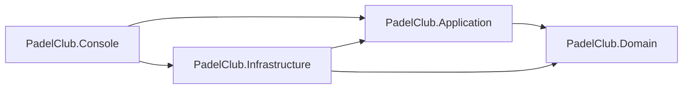

# PadelClub

Sample de lo que se espera del preparcial. La migración de EF Core está en `PadelClub.Infrastructure/Migrations`.

## Ejecución

La cadena está en `PadelClub.Console/appsettings.json`. Apunta a LocalDB, base `PadelClub`. Para otra instancia de SQL Server se cambia esa cadena y nada más.

```text
dotnet tool install --global dotnet-ef --version 9.0.10
dotnet ef database update --project PadelClub.Infrastructure --startup-project PadelClub.Console
dotnet run --project PadelClub.Console
```

`PadelClubDbContextFactory` existe para que `dotnet ef` arme el contexto leyendo la misma cadena.

## Semilla

| Cancha | Tipo | Techo | Precio |
|--------|------|-------|--------|
| 1 | Cristal | sí | 18000 |
| 2 | Cristal | no | 15000 |
| 3 | Muro | sí | 16000 |
| 4 | Muro | no | 14000 |

| DNI | Socio | Activo |
|-----|-------|--------|
| 30111222 | Ana Pérez | sí |
| 28999111 | Luis Gómez | sí |
| 33444555 | María Díaz | sí |
| 25666777 | Juan Ruiz | sí |
| 20123456 | Pedro Sosa | no |

## Capas



PadelClub.Console referencia Infrastructure para registrar la inyección. La carpeta del proyecto lleva ese nombre, y el namespace es `Consola` porque dentro de `PadelClub.Console` la palabra `Console` apunta al namespace y `Console.WriteLine` no compila. Los menús llaman a los servicios.

## Importe

`Reserva.Importe` copia `Cancha.PrecioPorTurno` en el alta. Si el martes cambia el precio de la cancha, la reserva del lunes sigue en el valor que se iba a cobrar. Consultar siempre el precio de la cancha reescribiría esa reserva.

## Patrones

Factory Method, en Domain, clase `Reserva`. `Reserva.Crear` es la única puerta de alta. Calcula `Fin` como el inicio más 90 minutos, copia el importe y aplica las reglas de horario y de fecha. Si el alta se armara en el servicio, `Fin` y `Importe` quedarían en manos de quien llame.

Template Method, en PadelClub.Console, clases `MenuPlantilla`, `MenuCanchas`, `MenuSocios` y `MenuReservas`. `MenuPlantilla.EjecutarAsync` fija el ciclo del submenú: mostrar, leer, ejecutar y pausar. Cada submenú completa sus opciones. Sin la plantilla, ese ciclo estaría copiado en cada uno.

Strategy no entra en esta versión. El preparcial cobra el precio vigente de la cancha, y una sola política de precio no llega a ser un uso real del patrón.

## Excepciones

El único `try/catch` está en el `while` de `Program`. Escribe la excepción en `errores.log`, junto al ejecutable, y en pantalla deja una línea sin stack trace. Después vuelve al menú principal. Una regla de negocio sale como `Result.Fallo`. Un dato mal tipeado no llega al servicio: `Lector` lo vuelve a pedir.

## R7

`ReservaRepositorio.BuscarSuperpuestaAsync` filtra en SQL. Hay cruce cuando una reserva activa de esa cancha cumple `existente.Inicio < fin && inicio < existente.Fin`. Con eso, 10:00-11:30 pisa 11:00-12:30 y no pisa 11:30-13:00.

## Lo que este sample no hace

Los tests xUnit de R7 y R9 no están. Irían en un proyecto aparte, llamando a `Reserva.Crear` y `Reserva.Cancelar` con un `DateTime` fijo.
